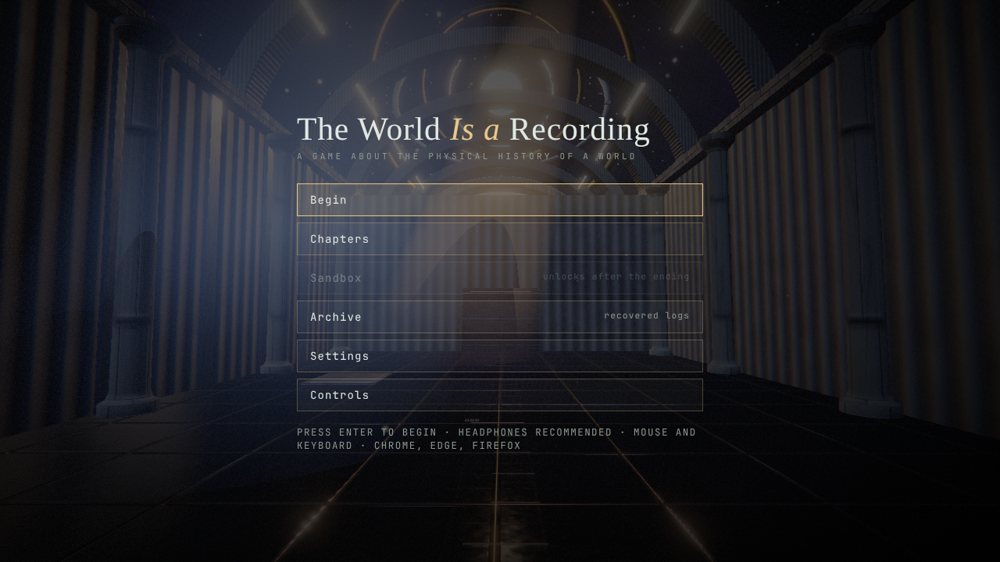

# The World Is a Recording

A first-person game about manipulating the **physical history** of a world. You are the *Recollector*, a machine
that records volumes of reality and replays them as physical forces. A replay does not rewind anything: the world
reconciles two conflicting histories by fixed, learnable rules — a door can stay open because it remembers being open,
a bridge can exist because it once did, a machine can run on remembered power, and light and sound recorded
yesterday still reach what stands here today.



## Play

Requires Node 20+ and a WebGL2 browser (Chrome, Edge, Firefox). Headphones recommended.

```sh
npm install
npm run dev        # http://localhost:5173
npm run build      # static build in dist/ ; npm run preview to serve it
npm test           # simulation tests + a bot that completes every chapter through the real controls
npm run e2e        # Playwright smoke test against `npm run preview` (needs Chromium)
```

Press **Enter** (or click **Begin**) on the title screen. Quality presets (Low → Ultra) are in Settings; if a GPU
rejects a preset the game steps down automatically.

### Controls
`WASD` move · mouse look · `Space` jump · `E` use / load tape · `Q` frame a volume (click pins, wheel resizes, right
click clears) · `R` record/stop · `1–6` slot · `T` play/pause · `Y` stop · `U` play all on the same tick · `L` mode
(once / loop / ping-pong / hold) · `G` reverse · `, .` scrub · `[ ]` rate · `Backspace` erase · `Z X C V B N M` sing notes ·
`Tab` state comparison · `K` return to checkpoint · `Shift+K` reset section · `F6` rewind · `Shift+Backspace` roll a slot back · `F5` save · `F3` developer overlay · `Esc` pause. Sandbox: `B` item, `Enter` place,
`Delete` remove, `F` link (`Shift+F` inverted), `J` note.

## The campaign

| | Chapter | New application of the mechanic |
|---|---|---|
| I | The Observation Chamber | recording, echoes that press plates, `hold` |
| II | The Machine That Remembers | machinery with memory; histories that **add** (flywheel superposition); *The Dead Field*: moving hazards, and a remembered switch that **subtracts** danger through a negated wire |
| III | The Architecture of Absence | archive tapes: simulated alternate histories, ghost operators, conflicting overlapping spans; *The Fork*: two incompatible histories and a **ledger** that makes one of them true (enforced by sealing; persists into later chapters) |
| IV | The Acoustic World | recorded voice, range and occlusion, chords across time; *The Carillon*: a melody mechanism whose locks demand the **reverse** order, or a **different tempo** |
| V | The Infinite Observatory | light and mirrors; time-shifted recordings made on a beat; *The Prism Hall*: dispersion into red/green/blue, timed shutters, colour-keyed sensors, two histories half a cycle apart |
| VI | The World Is a Recording | a reprise; *The Well*: a one-way descent, a floor that wears out (history does not), a crusher and a delayed lift; then the Master Record and two endings (Release / Hold); unlocks the Sandbox |

Most new sections have two or more verified solutions (`npm test` runs each variant). Each chapter has an optional experiment, hidden logs, and an economy rating (par = recordings used by the scripted
solution). Hints are on by default (`H`).

## How it works
* [docs/RECONCILIATION.md](docs/RECONCILIATION.md) — what a recording is and the eight reconciliation rules.
* [docs/ARCHITECTURE.md](docs/ARCHITECTURE.md) — modules, rendering, audio.
* [docs/LEVEL_FORMAT.md](docs/LEVEL_FORMAT.md) — authoring levels.
* [docs/KNOWN_LIMITATIONS.md](docs/KNOWN_LIMITATIONS.md) — read this before trusting any claim here.

Recordings store the actual simulation state vectors (change-compressed keyframes), not animations. The simulation is a
fixed 60 Hz deterministic `World` with no DOM or randomness; saving is an exact snapshot (verified by test).

## Verification status (what has and has not been checked)
* **Checked automatically:** simulation rules, determinism, snapshot/restore equality, and that all six chapters and
  their optional experiments are solvable through the real controls (`npm test`).
* **Checked in software-rendered Chromium (`npm run e2e`):** boot, menus, recording → playback → door, completion,
  save/load, every chapter rendering without console errors, audio output, the ending and the sandbox. Screenshots in
  `docs/screenshots/` were produced by that run.
* **Not checked:** real-GPU performance, human playtime (the "3–5 hours" target is unverified; the solver needs ~6
  minutes), human perception of audio. See Known limitations.

The earlier 2D prototype is preserved in `legacy-2d/`. License: MIT.
